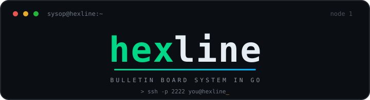
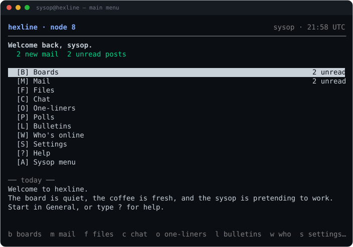
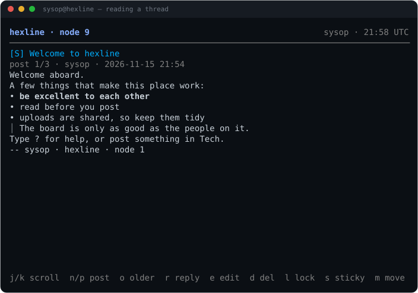
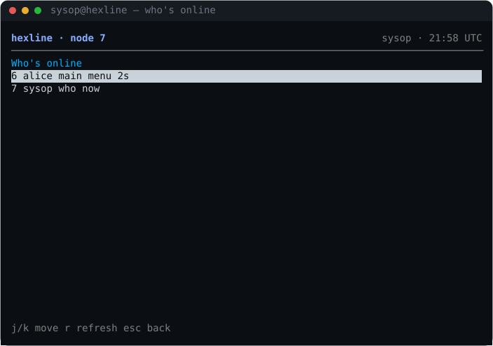

<p align="center">
  
</p>

<p align="center">
  <strong>A terminal-first bulletin board system in Go.</strong><br>
  SSH · message bases · mail · files · chat · one binary · SQLite
</p>

**Status:** v1.0 implemented. Licensed Apache-2.0.

## Screenshots

<p align="center">
  
</p>
<p align="center"><em>Main menu: new mail, unread counts and the MOTD. Everything is a hotkey.</em></p>

<p align="center">
  
</p>
<p align="center"><em>A thread: markup, quotes, signatures, and <code>o</code> to page backwards.</em></p>

<p align="center">
  
</p>
<p align="center"><em>Who's online: live nodes, activity and idle time.</em></p>

These are captures of a real SSH session, not mockups — regenerate them with
`python3 docs/screenshots/capture.py` (see [`docs/screenshots/README.md`](docs/screenshots/README.md)).

## Read this first

- [`docs/DESIGN.md`](docs/DESIGN.md) — vision, feature set, architecture, data model, security,
  NFRs, risks, decisions (§11)
- [`docs/TASKS.md`](docs/TASKS.md) — milestones M0–M6, task backlog with acceptance criteria,
  sequencing, v1.x stretch list

## What works

Message boards with threads, markup, unread tracking and FTS5 search · private mail with quotas and
blocklists · file areas with pipe upload/download, checksums and ratings · oneliners, polls,
bulletins and live chat · who's-online with idle state · registration with probation ·
moderation with per-area ACLs and an audit trail · sysop CLI and in-BBS menu · backups, migrations,
metrics and retention pruning.

Deliberately absent: telnet, ZMODEM, external doors, a web UI, QWK, Postgres (see DESIGN §3.3/§11).

## Quickstart

```sh
make build
export HEXLINE_DATA_DIR=$PWD/data

./bbs migrate
./bbs admin user create --handle sysop --role sysop   # prints a generated password
./bbs serve

# in another terminal
ssh -p 2222 sysop@127.0.0.1
```

Requires Go 1.26+ (the exact toolchain is pinned in `go.mod`). No Node, no database server,
no cgo. Prefer plain Go? `go build -o bbs ./cmd/bbs` does what `make build` does.

Prefer containers? The repo ships a distroless image and a compose example:

```sh
docker build -t hexline .
docker volume create hexline-data
docker run --rm -v hexline-data:/data hexline admin user create --handle sysop --role sysop
docker run -d --name hexline -p 2222:2222 -v hexline-data:/data hexline
```

Released builds (once a version is tagged) cover linux/darwin/windows on amd64/arm64 and a
multi-arch image at `ghcr.io/hacktobeer/hexline` — see
[`docs/ops.md`](docs/ops.md#releasing). For volumes, bind-mount ownership, backups and upgrades see
[`docs/ops.md`](docs/ops.md#docker).

Drive it without a terminal:

```sh
ssh -p 2222 sysop@127.0.0.1 whoami
ssh -p 2222 sysop@127.0.0.1 get UPLOADS/notes.txt > notes.txt
```

## Verify

```sh
make check                 # gofmt + vet + full test suite
go test -race ./internal/...   # concurrency-sensitive packages
go test ./internal/render -run '^$' -fuzz FuzzSanitize -fuzztime 30s
```

The tests include a cross-service caller journey (`internal/integration`), real SSH client
end-to-end tests (`internal/transport/ssh`), a traversal corpus for uploads, and screen-render
assertions. `cmd/loadgen` measures session and keystroke latency against a live board.

## Documentation

- [`docs/ops.md`](docs/ops.md) — install, systemd, backup/restore, upgrades, monitoring, troubleshooting
- [`docs/moderation.md`](docs/moderation.md) — moderator and sysop workflows, audit log
- [`docs/deps.md`](docs/deps.md) — every dependency and why it exists

## Decisions so far

| | |
| --- | --- |
| D1 | SSH only — no telnet |
| D2 | No ZMODEM/XMODEM, no external doors (declined, not deferred) |
| D3 | Open registration with new-user probation |
| D4 | Read-only web mirror after v1.0 |
| D5 | QWK offline mail deferred to v2 |
| D6 | SQLite only (repository interfaces keep Postgres possible) |
| D7 | English-only UI, strings centralized |
| D8 | Separate message and file areas |
| D9 | Probation: auto-promote at 3 days + 10 posts |
| D10 | Chat: global + sysop channels only |

No open questions remain (DESIGN §11).

## Review checklist

1. Scope: does §3.1 (v1.0) match what you want? §3.3 lists what is declined and why.
2. Estimate: ≈38.75 dev-days to v1.0 (`TASKS.md`, end of file).

## License

Apache License 2.0 — see [LICENSE](LICENSE).
